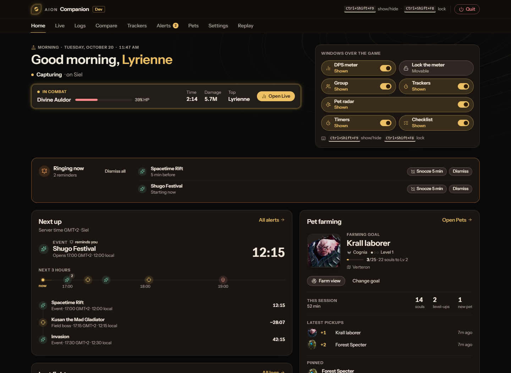
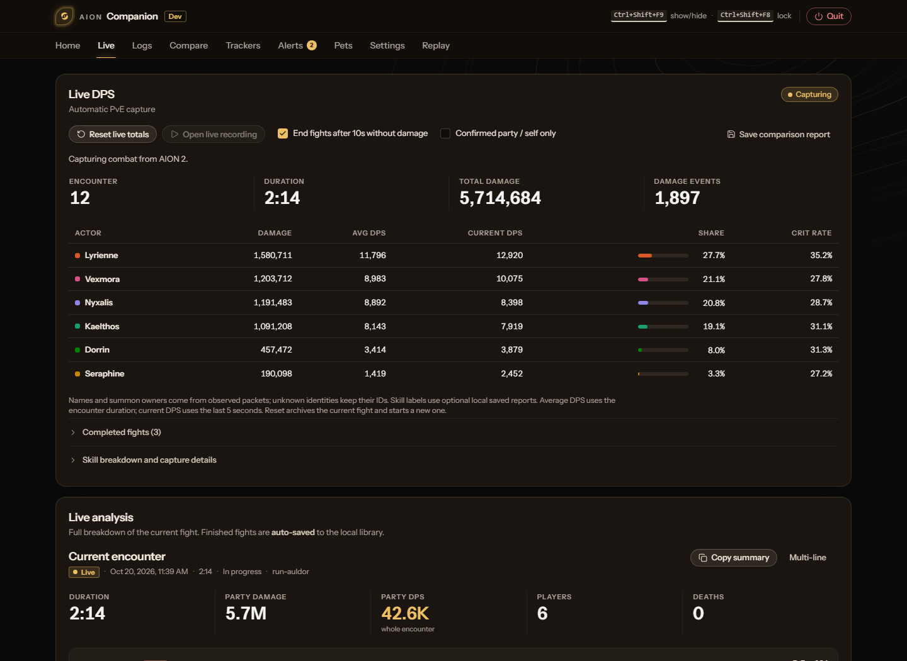
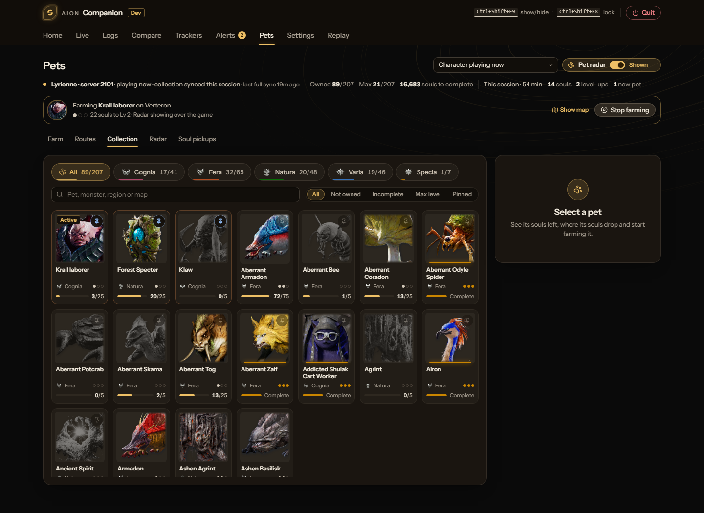

<h1>Aion Companion</h1>

<strong>A standalone Windows combat companion for AION 2.</strong> 
Live DPS, group inspection, boss alerts and pet farming, all kept on your PC.

<a href="https://github.com/nicholascostadev/aion-companion-public/releases/latest"><strong>Download for Windows</strong></a>
&nbsp;·&nbsp;
<a href="#features">Features</a>
&nbsp;·&nbsp;
<a href="#install">Install</a>
&nbsp;·&nbsp;
<a href="#privacy">Privacy</a>

 

Screenshots use the app's built-in demo data, not a real character.

> [!IMPORTANT]
> Aion Companion is **experimental** and **unsigned**, so Windows may show an
> unknown-publisher warning. Download it only from this repository's
> [releases](https://github.com/nicholascostadev/aion-companion-public/releases/latest)
> and check the published `SHA256SUMS.txt` before running it.

## Features

- **Combat.** Live encounters with active and rolling DPS, per-player and per-skill
  breakdowns, healing, incoming damage and boss HP. A compact meter ranks players;
  select a row to see that player's skills.
- **Logs and reports.** Searchable encounter history with run grouping, labels and
  comparisons. Reports cover rotations, openers, buffs, death recaps, timelines and
  training-dummy sessions.
- **Group.** Roster class, level, gear score, Combat Power and readiness, with
  profiles you can inspect and compare before joining a room.
- **In-game windows.** Borderless DPS, Group, tracker, Timers, Cube Finder and
  Gathering panels over the game, with click-through locking, tray controls and
  configurable shortcuts.
- **Alerts and timers.** Event and boss reminders with regional calendars, observed
  respawns, sounds, snooze and quiet hours. 73 field bosses ready to enable by name
  and map.
- **Pets.** Collection progress across five families, pinned farming targets on the
  original map terrain and a live nearby-monster radar.
- **Explore.** Cube and gathering locations for Altgard and Verteron on one map,
  with resource filters, layer controls and distances from your position.
- **Backups.** Native backups with previews and rollback copies, plus bug reports
  you review and send yourself.

<table>
<tr>
<td width="50%" valign="top">

<strong>Live combat</strong>

</td>
<td width="50%" valign="top">

<strong>Pets</strong>

</td>
</tr>
</table>

## Install

1. **Download Setup.** Get **AionCompanion-&lt;version&gt;-windows-x64-setup.exe**
   from the [latest release](https://github.com/nicholascostadev/aion-companion-public/releases/latest).
2. **Run Setup and open the app.** Setup installs for your Windows account, adds a
   Start menu shortcut and an uninstaller, and installs WebView2 if it is missing.
   Your saved data is kept across upgrades.
3. **Optional: install Npcap for live features.** Quit Aion Companion first (tray
   menu → **Quit Aion Companion**), install [Npcap](https://npcap.com/#download)
   with its default options, then reopen the app. Home and Settings explain what
   Npcap does and check that it works.

Start AION 2 in **windowed or borderless** mode and log into a character; capture
connects on its own.

### Requirements

| Requirement                              | Needed for                                    | Notes                                                                     |
| ---------------------------------------- | --------------------------------------------- | ------------------------------------------------------------------------- |
| **Windows 10 / 11, x64**                 | Everything                                    | No 32-bit, ARM64 or Windows 7/8.                                          |
| **Microsoft Edge WebView2**              | Opening the app                               | Setup installs it automatically.                                          |
| **[Npcap](https://npcap.com/#download)** | Live combat, live Group and the monster radar | Optional and installed separately. Logs, alerts and pets work without it. |
| **Windowed or borderless AION 2**        | In-game windows                               | Panels appear only while the game is focused.                             |

### Default shortcuts

| Shortcut      | Action                |
| ------------- | --------------------- |
| Ctrl+Shift+F9 | Show/hide DPS         |
| Ctrl+Shift+F8 | Lock/unlock the meter |
| Ctrl+Shift+F6 | Reset encounter       |
| Ctrl+Shift+F5 | Copy summary          |
| Ctrl+Shift+F4 | Compact strip         |

Shortcuts can be changed in Settings.

<strong>Portable ZIP, updates and uninstall</strong>

 

A portable ZIP is published alongside Setup. Extract it and run the executable,
installing the [WebView2 Runtime](https://developer.microsoft.com/en-us/microsoft-edge/webview2/)
yourself if needed. To update a portable copy, quit the tray app and replace the
executable. Portable and installed copies share the same saved data.

Installed copies check for new releases at startup, verify downloads against their
SHA-256 digests and switch versions only when you choose **Restart to update**.
Map artwork downloads the first time you open each map and stays cached for
offline use.

To repair an install, quit from the tray and run Setup again. Uninstall from
**Windows Settings → Apps**; your saved data, WebView2 and Npcap are left in place.

## Privacy

- **Local only.** Recordings, logs, settings, alerts and pet progress stay on your
  PC. There are no accounts, gameplay uploads or telemetry.
- **Receive-only capture.** With Npcap, the app reads the game's network traffic.
  It never sends or alters packets or modifies game files, and raw traffic is never
  saved or uploaded.
- **Updates come from GitHub.** Update checks and map downloads use this
  repository's releases and send no gameplay or character data.
- **Bug reports are manual.** Settings builds a file you can review and send
  yourself; nothing is uploaded automatically.

## Known limitations

- **Accuracy is still being validated.** Damage values are observed, never
  guessed. Anything that happened before capture started may stay unknown until the
  game sends it again. PvP and some regions are not yet verified.
- **Releases are unsigned.** Verify the download source and checksum; never turn
  off Windows protection to run the app.
- **Npcap is a kernel driver.** Install it only from its official site. Using a
  legitimate driver says nothing about the game's rules or anti-cheat decisions.
- **Cube and gathering locations are possibilities.** They do not confirm current
  availability or predict respawns.

## Building from source

See [CONTRIBUTING.md](CONTRIBUTING.md). Players never need Node.js, Rust or other
build tools.

## License

The app's original source code is available under the [MIT license](LICENSE).
Third-party software keeps the licenses listed in
[THIRD_PARTY_NOTICES.txt](THIRD_PARTY_NOTICES.txt).

**Game artwork and game data are not covered by the MIT license.** AION 2 class,
skill, pet and map artwork and game data remain the property of NCSOFT / NC
Corporation or their respective owners. See [artwork provenance](docs/GAME_ARTWORK.md)
before redistributing assets or binaries. Npcap is not redistributed.

Aion Companion is an unofficial fan project and is not affiliated with or endorsed
by NCSOFT.
